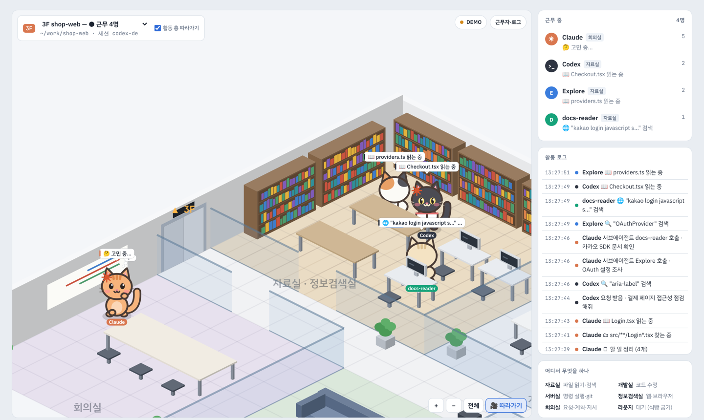
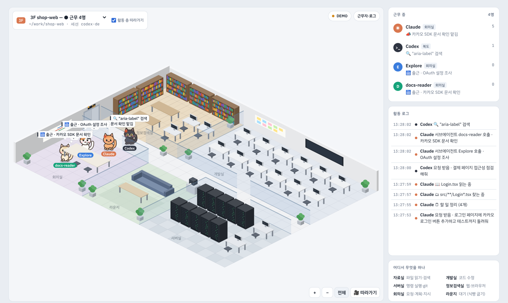

# 치이카와 관제탑 (chiikawa-controltower)

Claude Code와 Codex가 터미널에서 지금 무엇을 하고 있는지, 아이소메트릭 사무실에서 캐릭터들이 일하는 모습으로 보여주는 관제탑입니다.

파일을 읽을 땐 자료실에 가서 책을 펴고, 명령을 돌릴 땐 서버실 랙 앞에 서고, 막히면 그 자리에서 턱을 괴고 고민합니다. 일을 나눠 맡기면 서브에이전트가 엘리베이터를 타고 출근합니다.



- **설치할 패키지 없음**: Node.js 하나로 돌아갑니다.
- **훅·설정을 건드리지 않음**: Claude Code가 남기는 세션 기록(jsonl)을 읽기만 합니다. 대화에 아무것도 끼워 넣지 않으니 토큰 사용량에도 영향이 없습니다.
- **내 PC에서만 열림**: 서버는 `127.0.0.1` 에만 열립니다.

## 빠르게 시작하기

Node.js 18 이상이 필요합니다.

```bash
git clone https://github.com/AR0101/chiikawa-controltower.git
cd chiikawa-controltower
node get-pets.js     # 치이카와 캐릭터 그림 받기 (선택, 처음 한 번)
node server.js
```

브라우저에서 **http://localhost:4317** 을 엽니다. 이 상태로 다른 터미널에서 평소처럼 `claude` 나 `codex` 를 쓰면 캐릭터들이 실시간으로 움직입니다.

### 윈도우

1. [nodejs.org](https://nodejs.org) 에서 LTS 버전을 설치합니다.
2. 이 저장소를 ZIP으로 받아 압축을 풉니다 (초록색 `Code` 버튼 → `Download ZIP`).
3. 폴더 안의 **`start-windows.bat` 를 더블클릭**합니다. 처음 한 번은 캐릭터 그림을 받고, 브라우저가 열리면서 관제탑이 켜집니다.
4. 검은 창을 닫으면 관제탑도 꺼집니다.

## 사무실 안내

| 방 | 이럴 때 가요 |
|---|---|
| 📚 자료실 | 파일 읽기, 검색 (Read · Grep · Glob) |
| 🧭 정보검색실 | 웹 검색, 웹 페이지 읽기, 브라우저 테스트 (WebSearch · WebFetch · Playwright 같은 브라우저 MCP) |
| 💻 개발실 | 코드 수정 (Edit · Write). 쓰는 동안 모니터에 코드가 흐릅니다 |
| 🗄 서버실 | 명령 실행, git (Bash). 실행 중에는 랙 불빛이 빨라집니다 |
| 🗒 회의실 | 요청 받기, 계획 세우기, 할 일 정리, 서브에이전트에게 일 맡기기 |
| 🛋 라운지 | 일을 끝내고 다음 지시를 기다리는 중 |
| 🛗 엘리베이터 | 서브에이전트가 타고 출근했다가, 보고를 마치면 타고 퇴근합니다 |

- 도구를 쓰는 사이에 생각하는 동안에는 그 자리에서 고민하고, 명령이 실패하면 식은땀을 흘립니다.
- **프로젝트 하나가 한 층**입니다. 위쪽 선택 상자에서 층을 고르면 `▲ 3F` 엘리베이터 표시와 함께 그 층으로 이동합니다. 지금 일하는 층에는 ●가 붙습니다.
- 같은 프로젝트에서 세션을 여러 개 돌리면 **Claude, Claude 2, Claude 3…** 이 각자 다른 캐릭터로 출근합니다. `/clear` 로 버려진 세션은 조용해지면 알아서 퇴근합니다.
- 🎥 **따라가기**를 켜 두면 일하는 캐릭터들이 있는 곳으로 자동 확대됩니다. 휠이나 두 손가락으로 확대하고, 드래그로 옮기고, `전체` 를 누르면 사무실 전체가 보입니다.
- 세로 화면에서는 사무실만 크게 보이고, `근무자·로그` 버튼을 누르면 근무자 목록과 활동 로그가 열립니다.



## Codex도 출근

`~/.codex/sessions/` 에 있는 Codex 기록(최근 3일)도 같이 읽습니다. 같은 폴더에서 일하는 Codex는 Claude와 같은 층에 **Codex**(`>_`)로 출근합니다.

Codex는 파일 읽기와 검색도 셸 명령으로 하기 때문에, 명령을 보고 방을 정합니다.

| Codex 명령 | 가는 곳 |
|---|---|
| `rg`, `grep`, `Select-String` | 자료실 (검색) |
| `cat`, `sed -n`, `Get-Content` | 자료실 (읽기) |
| `ls`, `find`, `Get-ChildItem` | 자료실 (둘러보기) |
| `apply_patch` | 개발실 (코드 수정) |
| 그 밖의 명령 | 서버실 |

`codex exec` 로 불린 Codex는 일을 마치면 잠깐 쉬었다가 퇴근합니다.

## 캐릭터

### 치이카와 친구들 (Codex 펫)

[heelee912/chiikawa-dots-pets](https://github.com/heelee912/chiikawa-dots-pets) 의 Codex 펫 v2 스프라이트시트를 그대로 읽습니다.

```bash
node get-pets.js                  # 11마리 모두
node get-pets.js chiikawa usagi   # 일부만
```

그림은 이 폴더의 `pets/` 에만 받습니다. Codex 폴더는 건드리지 않습니다. `~/.codex/pets/` 에 이미 설치한 펫이 있으면 그것도 찾아서 씁니다.

- 첫 번째 Claude는 치이카와, 그다음은 하치와레·우사기·모몽가… 순서로 한 마리씩 맡습니다.
- 걷기, 작업, 고민, 실패, 대기 동작이 각각 펫의 동작으로 이어집니다.
- 펫 그림은 캐릭터마다 칸을 채우는 크기가 달라서, 실제로 그려진 부분을 재서 크기를 맞춥니다. 배율은 `public/index.html` 의 `PET_SIZE` 에서 바꿀 수 있습니다.

> 치이카와 스프라이트는 비공식 팬 작품이고 재배포가 허용되지 않습니다. 그래서 이 저장소에는 그림을 넣지 않았고, `get-pets.js` 가 원본 저장소에서 받아 옵니다. 치이카와와 관련 캐릭터의 권리는 나가노(ナガノ)와 각 권리자에게 있습니다.

### 내 그림 쓰기

`characters/` 폴더에 PNG를 넣으면 펫보다 우선해서 그 그림을 씁니다.

- `claude.png`: 메인 Claude
- 그 밖의 이름: 서브에이전트에게 이름 순서대로 배정
- `이름-walk.png`, `이름-work.png`, `이름-think.png`, `이름-sad.png`, `이름-sleep.png` 를 넣으면 자세별로 그 그림을 씁니다

### 아무것도 없으면

기본 고양이 캐릭터로 그립니다. 그림을 받지 않아도 바로 쓸 수 있습니다.

## 설정

| 바꾸고 싶은 것 | 방법 |
|---|---|
| 포트 | `PORT=5000 node server.js` |
| Claude Code 기록 위치 | `CLAUDE_PROJECTS_DIR=/경로/.claude/projects node server.js` |
| Codex 기록·펫 위치 | `CODEX_HOME=/경로/.codex node server.js` |
| 데모만 보기 | http://localhost:4317/?demo |

## 동작 방식

```
~/.claude/projects/<프로젝트>/<세션>.jsonl ─┐
~/.codex/sessions/YYYY/MM/DD/rollout-*.jsonl ┴─▶ server.js ──(Server-Sent Events)──▶ 브라우저 (public/index.html)
```

1. `server.js` 가 세션 기록 파일들을 0.25초마다 확인하고, 새로 쓰인 줄만 읽습니다. 최근 10분 동안 바뀌지 않은 파일은 5초마다 확인합니다.
2. 기록 한 줄을 화면용 이벤트로 바꿉니다. `tool_use` 는 그 도구에 맞는 방으로 걸어가기, `tool_result` 는 잠깐 뒤 고민하는 자세, 서브에이전트 기록은 따로 캐릭터를 만드는 식입니다.
3. 브라우저는 캔버스에 사무실과 캐릭터를 그립니다. 외부 라이브러리는 쓰지 않습니다.

기록 파일이 수백 MB로 커져도 처음 볼 때는 끝부분만 읽고, 한 번에 4MB 넘게 읽지 않습니다.

## 파일

| 파일 | 하는 일 |
|---|---|
| `server.js` | 세션 기록을 따라 읽고 브라우저로 보내는 서버 |
| `public/index.html` | 사무실 화면 |
| `get-pets.js` | 치이카와 펫 그림 받기 |
| `start-windows.bat` | 윈도우에서 더블클릭으로 실행 |
| `characters/` | 내 그림을 넣는 폴더 |

## 알려진 한계

- 권한 승인 대기는 기록 파일에 남지 않아서 표시되지 않습니다.
- Claude Code나 Codex의 기록 형식이 바뀌면 일부 동작이 안 보일 수 있습니다.

## 라이선스

코드는 [MIT](LICENSE) 입니다. 치이카와 캐릭터 그림은 이 라이선스에 포함되지 않습니다.
